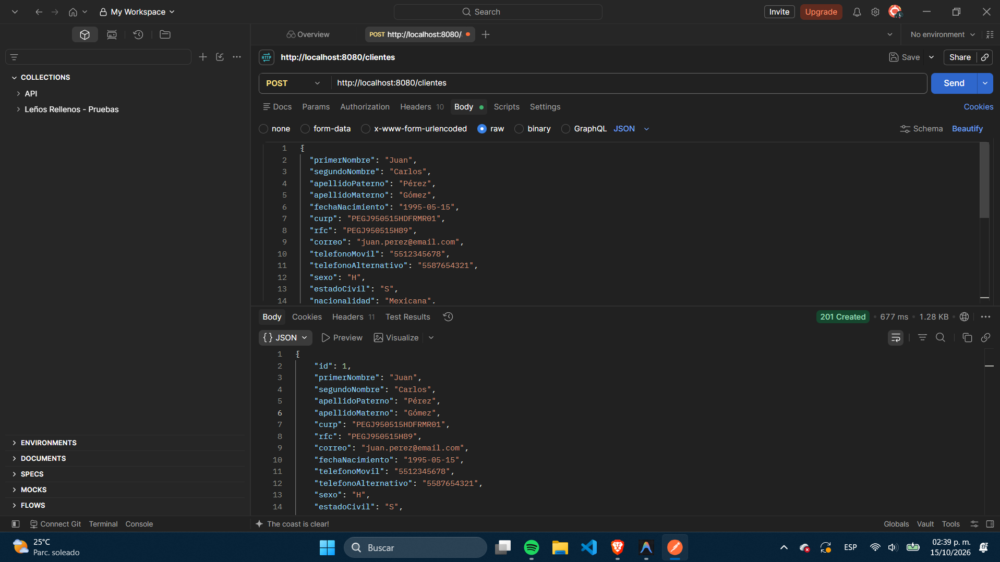
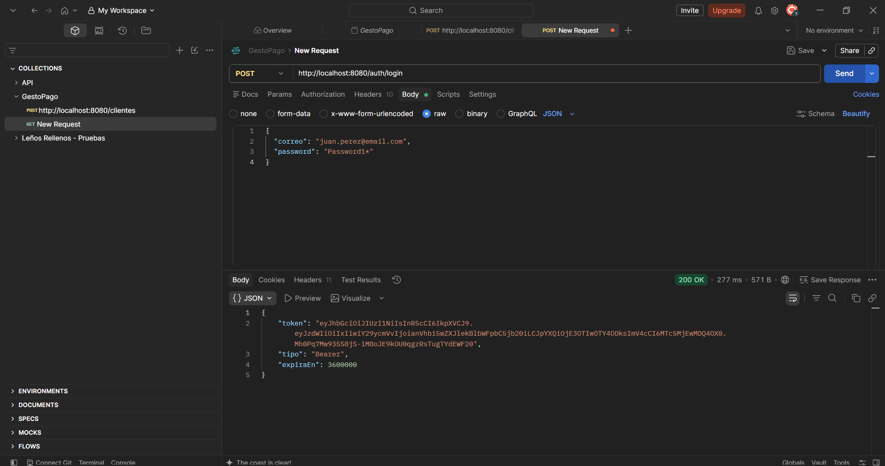
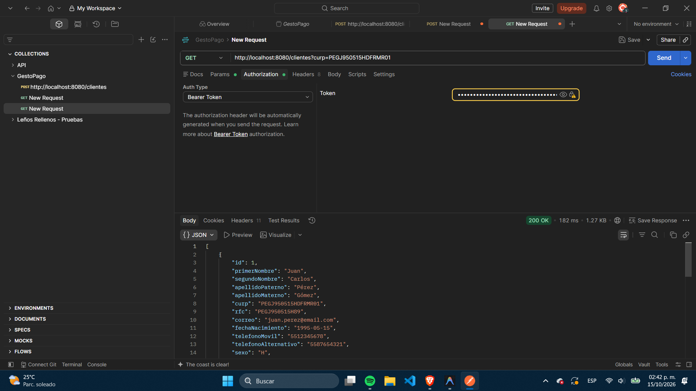
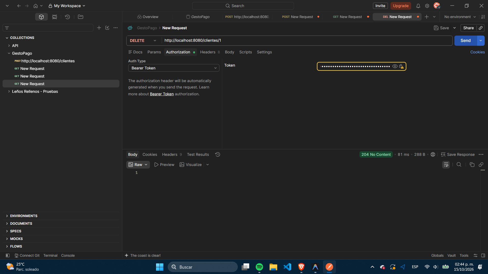
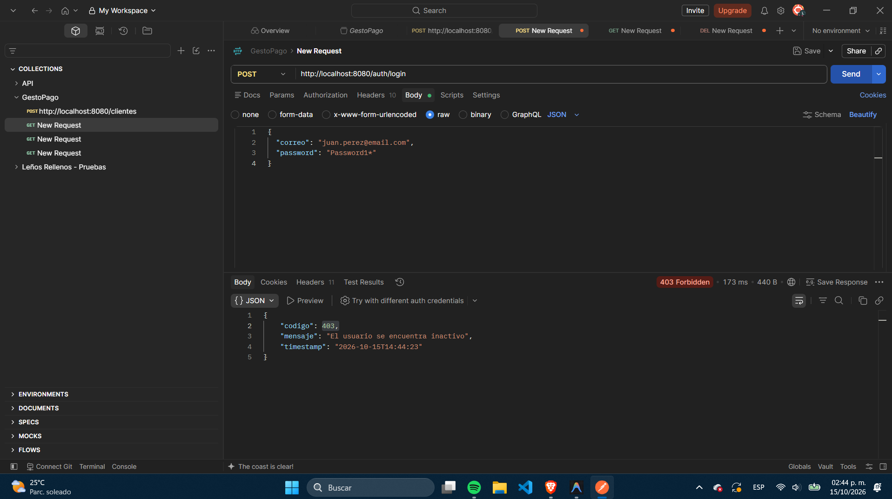

# Evidencias de Ejecución y Pruebas del Sistema

Este documento recopila las evidencias gráficas y de ejecución correspondientes a las pruebas automatizadas del proyecto y la verificación de endpoints mediante Postman.

---

## 1. Resumen de Ejecución de Pruebas Automatizadas (`./gradlew test`)

- **Resultado de la Suite:** `BUILD SUCCESSFUL`
- **Total de Pruebas Ejecutadas:** 77 pruebas
- **Pruebas Exitosas:** 77
- **Pruebas Omitidas:** 0
- **Cobertura de Componentes:**
  - Pruebas Unitarias de Servicios (Cliente, Cuenta, Usuario, Autenticación).
  - Pruebas Unitarias de Validadores Personalizados (`@MayorDeEdad`, `@PasswordSegura`, CURP, RFC, Teléfono, CP, Nombres).
  - Pruebas Unitarias de Controladores (`MockMvc` standalone con `GlobalExceptionHandler`).
  - Pruebas Unitarias del Manejador Global de Excepciones (`GlobalExceptionHandlerTest`: 404, 409, 401, 403, 400).
  - Pruebas de Integración End-to-End (`@SpringBootTest` con base de datos H2 en memoria y Flyway V2).
  - Pruebas de Integración de Filtros Dinámicos vía DTO (`ClienteFiltrosDinamicosIntegrationTest`).
  - Pruebas de Integración de Rechazo de Campos Desconocidos y No Modificables (`ClienteCamposDesconocidosIntegrationTest`).

---

## 2. Evidencias Gráficas de Endpoints (Postman)

### A. Registro Exitoso de Cliente (`POST /clientes`)
Se envía el JSON completo con datos personales, domicilio, ocupación y contraseña. El sistema responde con un código **201 Created**, generando la cuenta bancaria automática con saldo inicial `0.00` y el usuario asociado.

> 

---

### B. Autenticación y Generación de Token JWT (`POST /auth/login`)
El usuario inicia sesión utilizando su correo electrónico y contraseña segura. El sistema valida las credenciales y genera exitosamente el token **Bearer JWT** con un código **200 OK**.

> 

---

### C. Consulta con Filtros Dinámicos (`GET /clientes?curp=...`)
Utilizando el token Bearer en los headers de autorización, se realiza la consulta flexible filtrando por CURP, retornando de forma eficiente el registro correspondiente con código **200 OK**.

> 

---

### D. Baja Lógica en Cascada (`DELETE /clientes/{id}`)
Se ejecuta la baja lógica del cliente. El sistema procesa la petición de manera transaccional desactivando al cliente, sus cuentas y su usuario asociado, respondiendo con un código **204 No Content**.

> 

---

### E. Bloqueo Inmediato por Inactividad (`403 Forbidden`)
Al intentar iniciar sesión nuevamente con las credenciales del cliente dado de baja, el filtro de seguridad intercepta la petición y deniega el acceso respondiendo con un código **403 Forbidden** y el mensaje de usuario inactivo.

> 